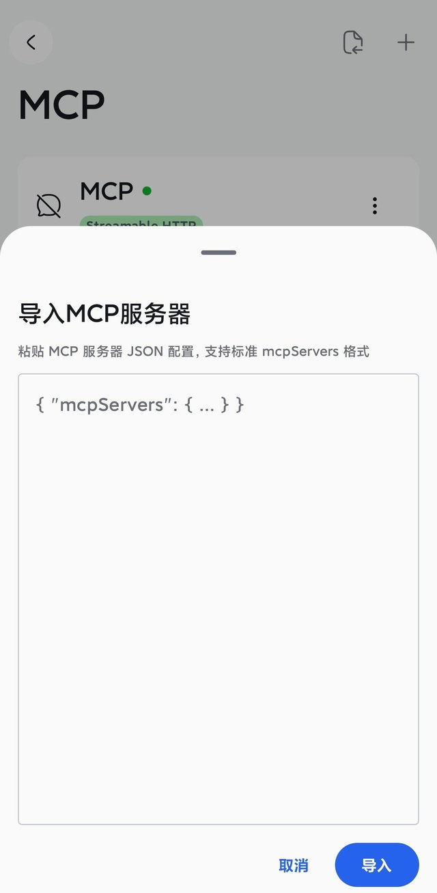
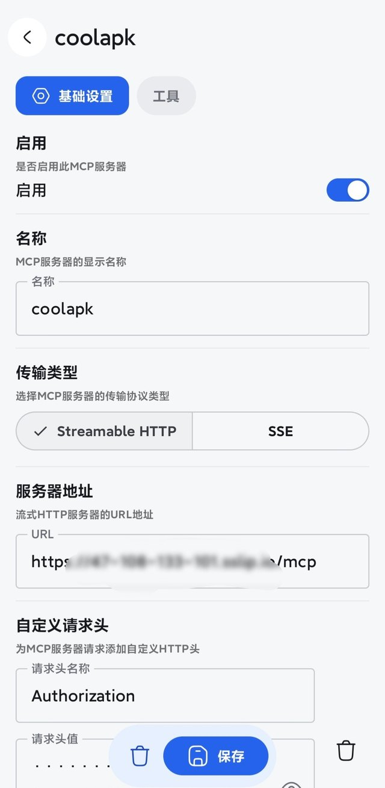

# 手机端接入指南（以 RikkaHub 为例）

> 手机上跑不了本地进程，所以手机 AI 客户端只能连**远程形态**：一台服务器上的 `streamable-http` 地址 + 一个 Bearer Token。
> 本文以 [RikkaHub](https://github.com/rikkahub/rikkahub) 为例，从零写到能搜帖、能看图。同类的 [Kelivo](https://github.com/Chevey339/kelivo)、超级小爱见文末「其他手机客户端」。

---

## 0. 先确认你手上有什么

接入手机端只需要两个值，它们来自服务器（怎么搭服务器见 [AGENT-SETUP.md](../AGENT-SETUP.md) 路线 B）：

| 需要的值 | 长什么样 | 从哪来 |
| - | - | - |
| MCP 地址 | `https://<你的域名>/mcp` | 服务器 systemd 里的 `COOLAPK_HTTP_PORT` + 反代域名，**结尾必须带 `/mcp`** |
| Bearer Token | 一串 43 位随机字符 | 服务器 systemd 里的 `COOLAPK_HTTP_TOKEN` |

手机端**不需要**装酷安桌面端、**不需要** root、**不需要**在手机上登录酷安——登录态在服务器上，手机只负责发请求。

> 没有服务器？手机端就用不了。酷安 MCP 的本地形态（stdio）需要一个本地进程，手机客户端无法拉起。

---

## 1. 安装 RikkaHub

从 [GitHub Releases](https://github.com/rikkahub/rikkahub/releases) 下载 APK 安装（Android 原生 Compose 写的，体积比其他同类小）。

装完先配一个模型提供商，否则没有模型可以调用工具：

1. 打开 **设置 → 提供商**，添加你的模型服务（OpenAI 兼容 / Google / Anthropic，或填自己的 base URL）
2. 填入 API Key，选一个模型，回到对话页发一句话确认能正常聊天

---

## 2. 导入 MCP 配置（最快的方式）

RikkaHub 的 MCP 页面右上角有导入按钮，**支持标准 `mcpServers` JSON**，不用一项项手填。

1. 打开 **设置 → MCP**，点右上角导入图标
2. 把下面这段粘进去（把地址和 Token 换成你自己的），点「导入」



```json
{
  "mcpServers": {
    "coolapk": {
      "type": "streamable_http",
      "url": "https://<你的域名>/mcp",
      "headers": {
        "Authorization": "Bearer <TOKEN>"
      }
    }
  }
}
```

字段说明（对应 RikkaHub 的导入解析逻辑）：

| 字段 | 作用 | 注意 |
| - | - | - |
| `mcpServers` 下的键名 | 服务器显示名（这里叫 `coolapk`） | 随便起，自己认得就行 |
| `type` | 传输类型 | 必须是 `streamable_http`；只有老服务端才用 `sse`。省略时默认就是 `streamable_http` |
| `url` | MCP 端点 | **结尾的 `/mcp` 不能少**，少了会 404 |
| `headers` | 自定义请求头 | `Authorization` 的值是 `Bearer ` + Token，**`Bearer` 后面有一个空格** |

> ⚠️ 最常见的错误是 `Bearer` 写了两遍（`Bearer Bearer xxx`），直接 401。JSON 里已经带了前缀，别再手动加。

---

## 3. 逐项核对服务器配置

导入成功后点进这个服务器，对着下面这张图核一遍：



| 项目 | 应该是什么 |
| - | - |
| **启用** | 开关打开 |
| **名称** | `coolapk`（或你导入时用的键名） |
| **传输类型** | `Streamable HTTP`（不要选 SSE） |
| **服务器地址** | `https://<你的域名>/mcp` |
| **自定义请求头** | 名称 `Authorization`，值 `Bearer <TOKEN>` |

「工具」标签页里能看到 13 个工具（`coolapk_search`、`coolapk_feed_detail`、`coolapk_topic`、`coolapk_author`、`coolapk_author_digest`、`coolapk_suggest`、`coolapk_user_profile`、`coolapk_user_feeds`、`coolapk_home`、`coolapk_login_status`、`coolapk_read_image`、`coolapk_image_link`、`coolapk_get_url`），可以按需关掉不想暴露给模型的。

---

## 4. 验证跑通（四个问题，按顺序问）

| # | 你在对话里说 | 期望结果 |
| - | - | - |
| 1 | 「调用 `coolapk_login_status` 看看登录状态」 | 返回 `is_logged_in: true`、`uid`、`username`。要是 `false`，说明服务器上的登录态没配好 |
| 2 | 「搜一下『Magisk 模块』话题」 | 返回话题列表，每条带关注数/讨论数。数量为 0 才需要排查 |
| 3 | 「进【小米解锁BL】话题，按热度排一下，给我前三条」 | 出现莫离然然那类长教程帖，带点赞/评论数 |
| 4 | 「找找莫离然然这个作者，把他多页作品按质量分排一下」 | 返回作者画像（粉丝数、等级、领域）+ 若干篇帖子，按 `post_score` 降序 |

第 1 条就失败时别往下试，先看文末「常见问题」。

---

## 5. 让它显示图片（手机端必须多一步）

酷安图床对非酷安客户端的请求返回 **HTTP 567（防盗链）**，所以模型拿到的图片 URL 在手机上直接显示是坏的。RikkaHub 能显示图片，但链接得先转成签名外链：

> 「把刚才那些图片地址用 `coolapk_image_link` 转一下，然后用 markdown 图片语法展示」

`coolapk_image_link` 会返回 `https://<你的域名>/img?u=...&exp=...&sig=...` 形式的链接，默认 120 分钟有效（最长 7 天）。这类链接任何客户端都能直接渲染，不依赖 base64，也不占用对话上下文。

> 本地 stdio 形态不需要这一步——本地直接用 `coolapk_read_image` 把图片以 base64 返回给多模态模型。手机端走不了这条，只能用外链。

---

## 6. 常见问题

| 现象 | 原因 | 怎么修 |
| - | - | - |
| 一直 401 / 工具列表为空 | Token 错、多了 `Bearer` 前缀、或 Token 里带了空格 | 重新复制 `COOLAPK_HTTP_TOKEN` 原值，只保留一个 `Bearer ` |
| 404 | 地址少了结尾的 `/mcp`，或域名写错 | 补 `/mcp`；浏览器打开 `https://<域名>/health` 应返回 `{"status":"ok"}` |
| 连接超时 / 网络错误 | 服务器的 443 没放行、nginx 没起、证书过期 | 服务器上 `systemctl status coolapk-mcp nginx`；云厂商安全组放行 443 |
| 能连上但 `is_logged_in: false` | 服务器没建立酷安登录态 | 在服务器上按 AGENT-SETUP 路线 B 的登录章节建一次（`--sms` / `--cookie` / 从本机搬 `config.json`） |
| 图片显示为破图 / 567 | 直接把 `image.coolapk.com` 的地址给了模型 | 用 `coolapk_image_link` 转签名外链 |
| 搜索关键词返回 0 条 | 严格模式把结果全过滤了 | 明确要求「用 `strict: false` 再搜一次」，或用 `coolapk_suggest` 换更规范的关键词 |
| 工具调用很慢 | 服务端限速 1.2 秒/请求 + 缓存未命中 | 正常现象；同类查询第二次会命中 TTL 缓存，明显变快 |

---

## 7. 其他手机客户端

不同客户端的差别只在「怎么填 URL 和请求头」，服务端完全不用改。

| 客户端 | 支持协议 | 配置方式 | 备注 |
| - | - | - | - |
| **RikkaHub** | Streamable HTTP / SSE / STDIO | 可粘贴 `mcpServers` JSON 导入，也可手填 | 本文示例；原生 Compose，界面最贴系统 |
| **Kelivo** | Streamable HTTP / SSE / STDIO + OAuth | 手填 URL + Headers；可从 Cherry Studio / Chatbox 导入 | Flutter，多端统一，外观可定制 |
| **超级小爱** | Streamable HTTP | 只填名称 + 服务器地址 + Token（无自定义请求头） | 语音助手场景；图片只认公开链接，所以必须用 `coolapk_image_link` |
| **LastChat** | 同 RikkaHub（fork） | 同 RikkaHub | 重做了 UI、加了 RAG 记忆，项目较新 |

---

## 8. 安全提醒

- 这个 Token 等于你酷安账号的**读写能力**（虽然 MCP 只做只读操作，但 Token 本身可用于写接口），别贴群里、别截图外传、别提交进 git。
- 地址和 Token 泄露了就换：服务器改 `COOLAPK_HTTP_TOKEN` → `systemctl daemon-reload && systemctl restart coolapk-mcp` → 客户端里同步改请求头。
- 只在自己可控的服务器上部署；不要用别人的公共实例，那意味着你的搜索请求走别人的账号和设备指纹。

---

装好之后，怎么让 AI 搜得更准（关键词拆解、话题优先、作者锚定这套策略）见 [skills/coolapk-research/SKILL.md](../skills/coolapk-research/SKILL.md)。
